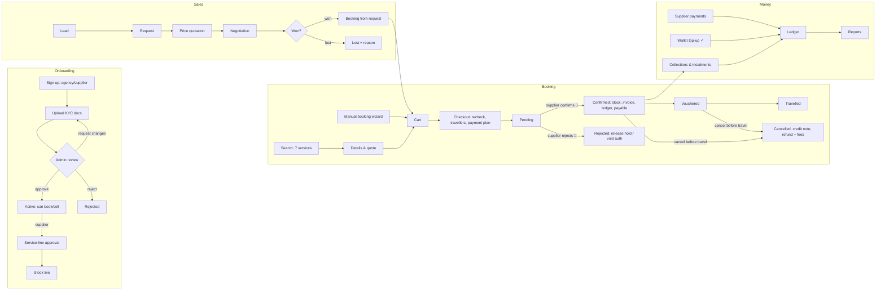

# Business Workflows

Rule IDs refer to `BUSINESS_RULES.md`. 🔶 marks a step that is **simulated** in the prototype and server- or external-authoritative in production.

## Workflow map

---

## W1: Agency/supplier onboarding (KYC)
1. **Sign up** (step 1): org type, company name (EN/AR), country, owner name/email/phone, password. Suppliers also pick their service lines. Creates the org (`pending_kyc`) and the owner user; plan `trialing` for agencies.
2. **Documents** (step 2): Commercial Register, Tax Card, Tourism License, each with a number, issue and expiry dates, and a file (stored locally 🔶). Submit → `submitted`. Platform notified.
3. **Review** (Compliance/Ops): the queue sorted by age; a side-by-side document viewer; per-document accept/reject; a case decision with a reason → logged (KYC-3).
4. **Approved** → org `active`. Owner notified 🔶. Supplier → service-line approval queue (KYC-6).
5. **Set up account**: markup defaults, financial accounts, team invites, credit limit (set by platform).
6. **Expiry watcher** (runs on the demo clock 🔶): T−30 warning → on expiry, block and notify → replacement upload → re-review → unblock (KYC-5).

## W2: Search → cart → checkout (B2B agency or B2C)
1. Choose a service tab. Hotels: destination, dates, rooms with adults/children (ages), nationality. Others: see their forms below.
2. The mock server queries extranet + manual inventory + **mock TBO/Hotelbeds adapters** 🔶 in parallel, maps and merges, then prices each offer through the **pricing engine** for the viewer's tenant/layer/channel (PRC-4..6).
3. Filters (price, stars, meal plan, refundable, source: Extranet/B2B/Global like v1, rating), sorting, pagination.
4. Details page: gallery, room/rate cards with cancellation policy, price breakdown appropriate to the viewer, a sticky cart summary (v1 UX).
5. Add to cart → a `PriceQuote` (15 min) is created.
6. Checkout:
   - recheck every item (QTE-2)
   - customer: pick or create a customer (B2B) or log in (B2C)
   - travellers per item (names, ages, passport for flights/visa/Umrah)
   - **payment**:
     - B2B: wallet/credit (WAL-2..4) or customer payment plan (full/partial/later)
     - B2C: card 🔶 or pay later if enabled
7. Submit → the booking is created with its `fxSnapshot` locked (FX-1). Items go `pending`, with wallet holds or card authorisation.
8. Supplier response per item 🔶:
   - **API**: the adapter `book()` returns confirm/reject/pending after a simulated delay.
   - **Manual/network supplier**: shows in the supplier portal or the agency ops board for confirmation.
9. Confirmation → BKG-3 side effects → notifications 🔶 → confirmation page and email/WhatsApp preview.

### Per-service booking details captured (P, service table)
| Service | Search inputs | Booking captures |
|---|---|---|
| Hotels | destination, dates, rooms × (adults, child ages), nationality | room type × qty, meal plan, supplements, guest per room, special requests, policy snapshot |
| Flights | one-way/round, from/to, dates, pax by type, cabin | passengers (passport), fare, baggage, PNR + ticket no. (entered at confirmation) |
| Tours | destination, date, pax types | departure, price per person type, transport, seats, hotel/room for multi-day, inclusions/exclusions |
| Visas | destination country, nationality, travel date | visa type, travel date, appointment date, passport + document uploads, notes |
| Umrah | season/month, departure city, room occupancy, pax | package, Makkah/Madinah nights, transport, flight, visa, **mahram** details, group leader |
| Activities | destination, date | slot (date/time), language, pax by age band, pickup point |
| Buses & transfers | from/to, date, pax/vehicle | seats or vehicle, departure/arrival, bus number, driver (filled by ops) |

## W3: Manual booking wizard (agency back office, main flow) [V1]
1. **To**: B2C customer/lead, or B2B (sub-agency). Can create one inline.
2. **From**: supplier (own manual supplier, network supplier, or extranet), service type, cost, currency, markup (% / fixed), tax type and rate. The live breakdown preview uses the domain rules.
3. **Details**: a per-service form (table above) and travellers.
4. **Cart**: add more items or check out (same as W2 step 6).

Sell price overrides need permission (PRC-9). The wizard draft is persisted so a refresh doesn't lose work.

## W4: Request pipeline (CRM)
Lead captured (source, owner) → request (service, destination, dates, pax, priority, expected revenue) → Kanban **work station** (v1) with drag or menu moves (CRM-1) → quotation (items priced via the engine, PDF preview, "send" 🔶) → negotiation (revise) → **won** → booking wizard pre-filled (CRM-2), or **lost** with a reason. Follow-ups (call/WhatsApp/email/meeting) carry due dates and an overdue list. Customer 360 shows requests, bookings, payments, notes and activity timeline.

## W5: Booking operations board
Columns: Pending (with hold reason and SLA badge) → Confirmed → Vouchered → Travelled, plus Cancelled/Rejected tabs. Also upcoming/current/past lists (v1).

Actions:
- confirm with supplier ref
- reject with reason
- issue voucher (BKG-6) → printable/PDF voucher
- resend voucher 🔶
- cancel (W7)
- add note
- view status history and audit.

## W6: Payments and instalments
- Plan creation at checkout or later from the booking: full/partial/later. The partial editor validates PAY-2 live.
- **Collect payment**: amount, date, split across financial accounts (PAY-3) → receipt → ledger. Instalments update; the invoice status updates.
- **Overdue board**: overdue instalments by age, with "send reminder" 🔶 and "collect".
- **Supplier payables**: per item, due/paid/remaining; "pay supplier" → ledger.

## W7: Cancellation and refund
Request cancel → fee preview from the policy snapshot (CAN-1/2) → reason → (approval if required, CAN-4) → API adapter `cancel()` 🔶 or a manual supplier acknowledgement → item `cancelled`, stock released, credit note, refund record (wallet credit or simulated card refund), ledger reversal, supplier payable reduced, notifications 🔶.

## W8: Wallet and credit
- The agency requests a top-up (amount, method, proof).
- Platform finance approves or rejects → balance, ledger, notification.
- Platform sets the credit limit.
- Bookings place holds and confirmation captures them.
- Over-limit bookings show in "Awaiting credit approval" for platform ops or the parent agency (WAL-4).
- Sub-agency wallets are funded by the parent agency through the same flow, one level down.

## W9: Supplier portal
- Products per approved service line (wizard modelled on the reference "Create New Hotel" flow: details → location → amenities → photos → rooms → rates & availability → policies → review).
- Availability calendar: bulk edit by date range and weekdays (replaces v1's 12 month routes).
- Pending reservations → confirm with a number or reject.
- Statement: bookings, net, commission, payable, payouts.

## W10: SaaS subscriptions
Platform manages plans (limits, features, price). The agency sees its plan, usage against limits, and upgrade/downgrade (SUB-4) with simulated checkout 🔶 and billing history (invoices). The platform sees all subscriptions, MRR and past-due. The demo clock drives renewals and grace periods.

## W11: Reporting
Dashboards per portal, filterable by date range, service, branch and agent:
- sales and bookings by status/service
- revenue and profit (from the ledger)
- receivables ageing and supplier payables
- agency performance (platform), agent performance (agency), supplier performance (acceptance rate, response time, cancellations)
- top destinations
- CSV export 🔶 (client-generated).

## W12: B2C storefront and mobile account
Register/login → bookings list (upcoming/past/cancelled) → booking detail with timeline → voucher download/share → cancel (W7, customer-initiated, within policy) → profile (travellers saved for reuse) → notifications → support tickets and FAQ.

## Demo clock
A single `now()` from the mock server, adjustable in the Demo panel. It drives overdue instalments, document expiry, quote expiry, auto-`travelled`, subscription renewals and reminders, so time-based rules can be shown in a demo.
