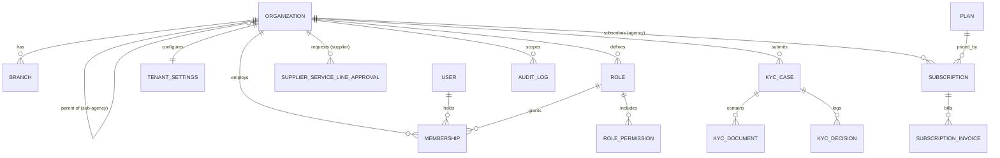
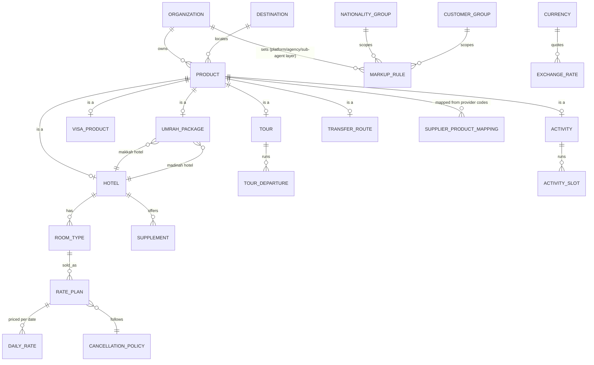
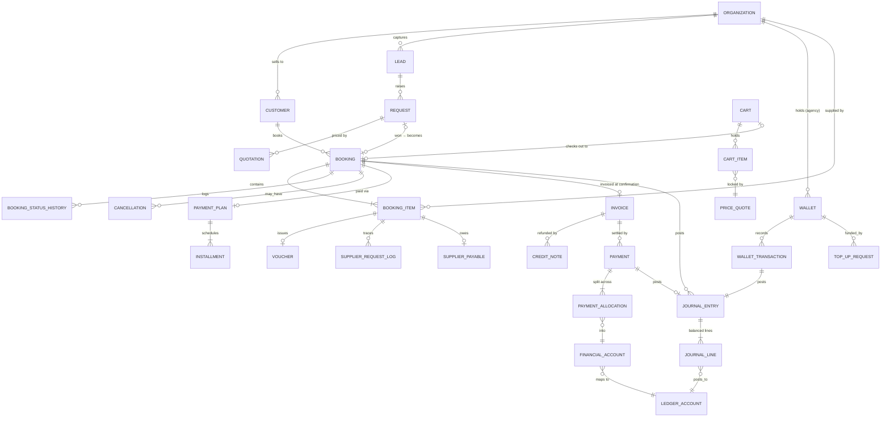

# Database ERD (future. Reference only)

Split into domains for readability. Mermaid renders on GitHub and in most Markdown viewers.

## Tenancy, access, KYC

## Catalog and pricing

## Sales, bookings, money

